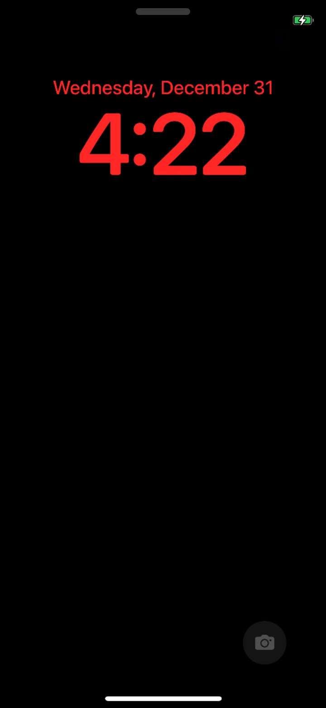
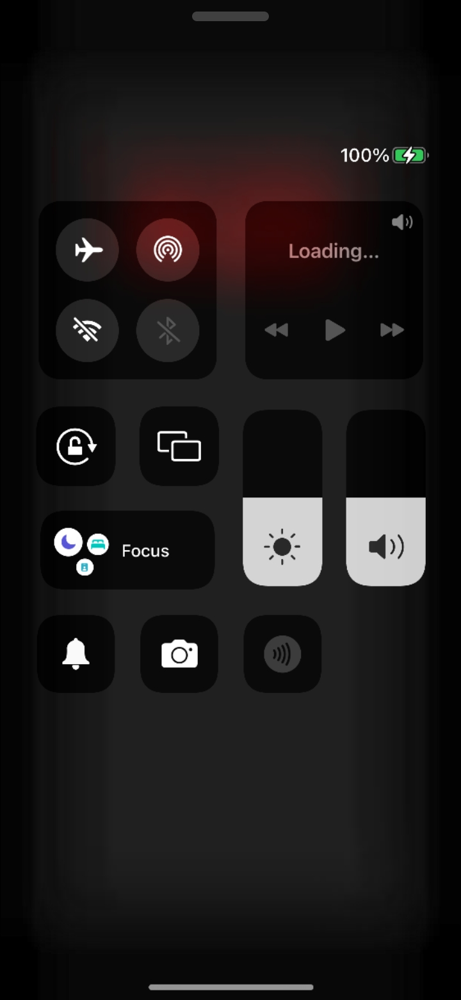
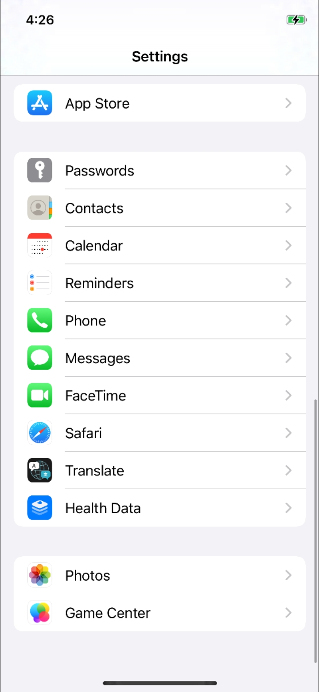
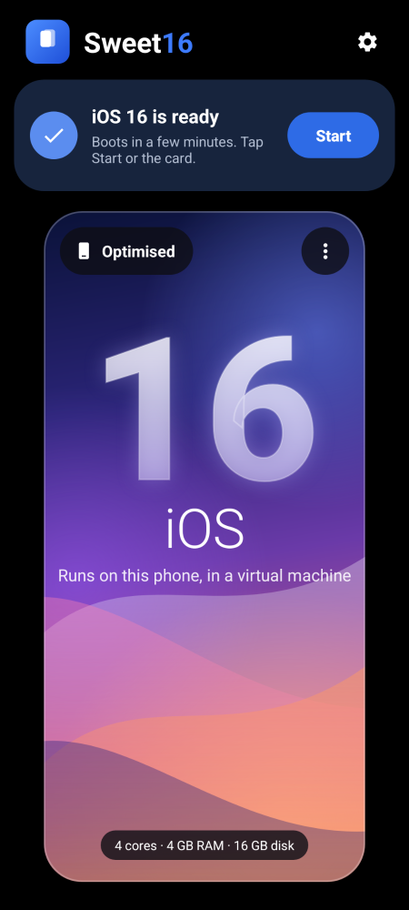

# ios-sweet / Sweet16

**Apple's iOS 16 running on Android phones.** Two ways:

- **Sweet16**, an Android app (APK) that runs iOS 16 in a virtual machine on any recent arm64 Android phone, with **no root and nothing flashed**. It's been shown on a **Samsung Galaxy S25 Ultra** booting to the iOS 16 lock screen, home screen and Settings.
- **The original bare-metal port** to the Xiaomi Redmi Note 10 Pro (`sweet`), where iOS 16 replaces Android and boots to the home screen.

Both run Apple's open-source XNU kernel (xnu-8796, the iOS 16 generation) with this project's patches, under the **unmodified iOS 16.7.16 (20H392) userland of the iPhone X**. iOS itself is Apple's and is not distributed here: you build the disk from an IPSW you download yourself.

> Experimental. Not a usable phone OS: no internet, sound, camera, App Store or GPU; everything is drawn by an emulated CPU and is slow. Apple's security model is mostly switched off, so don't put anything personal in it. Not affiliated with Apple.

<p>




</p>

*iOS 16 lock screen, Control Center and the Settings app inside Sweet16 on a Galaxy S25 Ultra (2026-11-13), and the Sweet16 launcher.*

## Sweet16: iOS 16 on your Android phone

### What you need

- An arm64 Android phone (Android 10 or newer), ideally a recent flagship: everything is emulated on the CPU. Tested: Galaxy S25 Ultra.
- About **40 GB free** while setting up, about 10 GB afterwards.
- The **iPhone X (iPhone10,3) iOS 16.7.16 (20H392)** IPSW, `iPhone10,3,iPhone10,6_16.7.16_20H392_Restore.ipsw` (about 6 GB). Find it on [ipsw.me](https://ipsw.me/iPhone10,3); it downloads from Apple's own servers. Use exactly this build: the kernel and the setup scripts are made for it.
- [Termux](https://f-droid.org/packages/com.termux/) from F-Droid or GitHub (not the outdated Play Store version), to build the iOS disk on the phone.
- A charger and patience: the disk build takes hours, the first iOS boot about an hour.

### 1. Install the app

Download `Sweet16-iOS16-arm64.apk` from the [latest release](../../releases/latest) and install it (allow installs from your browser or file manager). Newer versions install over older ones and keep your iOS disk.

Optional check that the emulator works: **⋮ → Developer boot (verbose, your files) → Boot**. The Console should show the kernel log and, after a few minutes, a `sweet#` prompt. Type `uname` and **Send**: the answer comes from the running iOS kernel. Stop it afterwards (⋮ → Stop).

### 2. Build the iOS disk on the phone (Termux, no root)

Put the IPSW in `Download`, then in Termux:

```sh
termux-setup-storage
pkg update -y && pkg install -y git qemu-system-aarch64-headless qemu-utils mtools dosfstools curl
git clone https://github.com/trickspert/ios-sweet-apk ~/ios-sweet-apk
termux-wake-lock
cd ~/ios-sweet-apk
bash tools/termux/mkiosroot-termux.sh "/sdcard/Download/iPhone10,3,iPhone10,6_16.7.16_20H392_Restore.ipsw" /sdcard/Download/rootfs.img
```

It starts a small Ubuntu VM (an unrooted phone can't mount disk images, the VM can) and runs `tools/mkiosroot.sh` and `tools/sweet-root-tweaks.py` inside it. Leave it running, charging, until it prints `== done: /sdcard/Download/rootfs.img` (about 4 hours on a Galaxy S25 Ultra). It also writes `DT-d22ap.bin`, the iPhone X device tree. Details: [`android/README.md`](android/README.md#building-the-ios-disk-on-the-phone-termux-no-root). A Linux PC works too (`tools/mkiosroot.sh`, README section below).

### 3. Set up Sweet16

1. **Import** → `Download/rootfs.img`. Wait for **"iOS 16 is ready"**.
2. **⋮ → Developer boot → Pick DeviceTree…** → `Download/DT-d22ap.bin`, and select **"Generated + /product from your Apple DeviceTree"**. iOS needs this to know it is an iPhone X; without it, it stays on the Apple logo.
3. **Settings (gear) → Battery: allow background use**, so Android doesn't stop the VM.
4. Optional: Settings → CPU cores (4 is the default; 6 on 8-core phones is faster).

### 4. Start iOS 16

Tap **Start**. You see the Apple logo for a long time on the first boot (about an hour, while iOS sets itself up), possibly a black screen, then the lock screen. Later boots are much faster: about 4 minutes on a Galaxy S25 Ultra. Touch works like an iPhone; your phone's **Back** = Home; the handle at the top gives Home, Lock, Volume, Kernel log and Stop. If it gets stuck: handle → **Kernel log → Copy log**, and open an issue with the log.

### What works in Sweet16 (2026-11-13)

| | |
| --- | --- |
| Kernel | XNU boots on 4 virtual CPUs, kernel console on the serial port |
| iOS userland | launchd, the system daemons, backboardd, SpringBoard |
| Screen | Apple logo, **lock screen**, **Control Center**, **home screen**, the **Settings** app (iOS draws at 1125×2436, shown at half size) |
| Input | Touch and swipes (virtual tablet), Home, Lock and volume buttons |
| Not working | Internet / Wi-Fi, sound, camera, GPS, Bluetooth, App Store, GPU; the date shows Dec 31 (no clock chip yet) |

### How Sweet16 works

```
Sweet16 app ── foreground service ── QEMU (Termux build, software CPU emulation, -M virt)
   │                                   ├─ XNU kernel + generated Apple device tree   (built by the app at each start)
   │                                   ├─ virtio disk     iOS 16 root (HFS+, made from your IPSW)
   │  screen + touch (VNC socket) ◄───►├─ ramfb display / virtio touch + keys
   │  console, CPU state              ◄─┴─ PL011 serial port, QMP
```

Kernel side: patch `xnu/patches/0082-sweet-virt-machine.patch` (virtio disk/input, serial console, multi-core, half-size display) and `0083` (builds with Xcode 16). App and scripts: [`android/README.md`](android/README.md). Everything is built by GitHub Actions (`.github/workflows/android.yml`: kernel on macOS, then the APK).

### What's not in this repository

The IPSW, the iOS disk (`rootfs.img`), the device tree (`DT-d22ap.bin`) and any other Apple file. They are Apple's copyrighted software: everyone builds them from their own IPSW with the scripts above (the Termux script writes `DT-d22ap.bin` too). Please don't upload them to issues, releases or forks.

## The original port: Redmi Note 10 Pro (bare metal)

On the Redmi Note 10 Pro (`sweet`, Snapdragon 732G) iOS 16 boots directly on the hardware: stock bootloader → `fastboot boot` of this project's shim → XNU with drivers for the phone's UFS storage, touch screen and buttons. As of **2026-10-18** it boots to the **iOS home screen**: unlock, Settings, Control Center, notification center, touch and buttons. It installs into the `userdata` partition and so **erases Android's user data**.

### What works

| Area | State |
| --- | --- |
| Boot | Stock Xiaomi bootloader → `fastboot boot` of our shim → XNU. Nothing is flashed to the boot partitions |
| CPU | 6 of the 8 cores (the six Cortex-A55s) via PSCI, 16K pages, GICv3 interrupts, timers |
| Memory | About 3.95 GiB of the upper DDR bank |
| Storage | Own UFS host driver; the iOS root is a journaled HFS+ volume in `userdata`, read/write |
| iOS userland | Real iPhone X 16.7.16 root filesystem and shared cache; launchd and the system daemons run |
| Display | Kernel IOSurface + IOMobileFramebuffer (`AppleCLCD`) services; CoreAnimation renders in software; frames are copied into the bootloader's framebuffer. Presented to iOS as an iPhone X panel (1125×2436) |
| GUI | backboardd, SpringBoard, lock screen, home screen, Control Center, notification center, Settings |
| Touch | Goodix GT9896 over I²C (GENI), rail enabled through RPMh, delivered as HID digitizer events |
| Buttons | Power, volume up/down (PMIC through SPMI) as HID consumer keys; lock/wake works |
| Battery | IOPMPowerSource service (static 100 %, charging icon; real fuel-gauge readout prepared) |
| Device identity | iPhone X (`iPhone10,3` / `D22AP`): no Home button, gesture UI |
| Activation | Native "Hactivation" path of mobileactivationd, chosen through device-tree security status. No Apple servers involved |

### What does not work (yet)

- **Navigation:** you cannot leave an app (the home gesture and AssistiveTouch Home do nothing yet).
- **No Wi-Fi, Bluetooth, cellular, audio, camera, sensors, GPS or SEP / Face ID.** Daemons for them start and fail or keep relaunching.
- **No GPU.** Everything is drawn by the CPU at roughly 20–30 fps. The two Cortex-A76 cores are not used yet.
- **Few apps.** The image has only what is on the system volume. There is no App Store, no Apple ID, and some Settings pages are empty.
- **Slow boot:** about 4 minutes on the Apple logo.
- **Security is off:** permissive code signing (AMFI) and sandbox policies, a stub AppleKeyStore, no data protection. Do not put anything personal on it.

### How it boots

```
ABL (stock Xiaomi bootloader, unlocked)
  -> fastboot boot shim-boot.img              (temporary; nothing is flashed to boot)
     -> shim: own MMU setup, reads the live FDT, loads the payload from the ramdisk
        -> XNU Mach-O + generated Apple Device Tree (ADT) + boot-args
           -> XNU -> UFS driver -> HFS+ root in the userdata partition
              -> dyld + shared cache -> launchd -> daemons -> backboardd + SpringBoard
```

There is no serial port (the debug UART is wired as SPI on this board). The kernel draws its console into the framebuffer that ABL leaves at `0x9c000000`, and keeps a persistent 4 MiB log ring at the end of `userdata`. You read that log from OrangeFox recovery with `tools/sweet-log-pull.sh`, so you don't have to film the screen.

### How to do it yourself

You need a Redmi Note 10 Pro (`sweet`, global or Indian variant, SM7150) with an **unlocked bootloader**, a Linux PC, and a GitHub account for the kernel build. This is the exact path used for the screenshots above; other variants or firmware may need changes. **Everything on `userdata` is lost.** Bootloaders, recovery, modem and persist partitions are never touched.

#### 0. Back up the phone

Boot OrangeFox (or any recovery with adb root) temporarily and pull at least `persist`, `modemst1`, `modemst2`, `fsg`, `fsc` and `boot`, `dtbo`, `vbmeta`. They contain per-device calibration data. Keep them off git; `.gitignore` already excludes `backup/`, `dtb/` and `recovery/`.

The shim needs the stock DTB. Unpack your phone's stock `boot.img`:

```sh
python3 tools/unpack_bootv2.py backup/boot.img dtb/boot_unpacked   # -> dtb/boot_unpacked/dtb
```

#### 1. Build the kernel

The kernel builds on GitHub's macOS runners with [blacktop/darwin-xnu-build](https://github.com/blacktop/darwin-xnu-build). The workflow fetches xnu-8796, applies `xnu/patches/` in order, and also stages the pinned open-source libpthread, HFS and BearSSL sources it needs. Fork the repo (public repos get free macOS minutes) and run:

```sh
gh workflow run xnu.yml -R YOU/ios-sweet
gh run download RUN_ID -R YOU/ios-sweet -n xnu-kernel -D xnu/out
```

To check a patch locally before spending a CI run, `tools/xnu-cc.py` replays the compile commands of a previous CI log for single files.

#### 2. Build the iOS root image

Download the iPhone X (iPhone10,3) iOS 16.7.16 (20H392) IPSW from Apple. Then, on Linux, with `apfs-fuse`, `hfsprogs` and sudo:

```sh
# OS, SystemOS and AppOS disk images from the IPSW (see BuildManifest.plist for their names)
tools/mkiosroot.sh OS.dmg SystemOS.dmg AppOS.dmg ios16-root.img 16G
sudo fsck.hfsplus -fy ios16-root.img
sudo mount -t hfsplus -o loop,force ios16-root.img /mnt/iosroot
sudo python3 tools/sweet-root-tweaks.py /mnt/iosroot
sudo umount /mnt/iosroot
img2simg ios16-root.img ios16-root.simg
```

`mkiosroot.sh` copies the OS volume and both cryptexes into one case-sensitive journaled HFS+ volume. It adds the dyld cache links, the plain system keybag and the log directories the daemons expect. `sweet-root-tweaks.py` applies the bring-up changes: it skips Setup, seeds the activation state, removes the baseband daemon, disables the watchdogs that kill slow apps and the crash-looping media paths, and so on. The script's header explains each change.

The device tree builder copies `/product` from the real iPhone X device tree, which MobileGestalt needs. Extract it once, without downloading the whole IPSW:

```sh
python3 tools/remotezip.py IPSW_URL DeviceTree.d22ap.im4p research/ipsw-x/dt
ipsw img4 im4p extract research/ipsw-x/dt/Firmware/all_flash/DeviceTree.d22ap.im4p -o research/ipsw-x/d22ap.adt
```

#### 3. Build the boot image

Needs `aarch64-linux-gnu-gcc` and `mkbootimg`.

```sh
python3 tools/mkadt.py shim/out/sweet.adt --highmem
python3 tools/mkpayload.py xnu/out/kernel.development.sweet shim/out/sweet.adt shim/out/payload.bin \
    --cmdline 'debug=0xc serial=3 cpus=6 keepsyms=1 -enable_kprintf_spam -noprogress rd=ufsroot0 unentitled_ios_sim_launch=1 ignition_level=1 wdt_test=no_user_checkin ufsrw=1 rootrw=1 launchd_unsecure_cache=1 wdt=-1 sweetfb_noconsole=1 sweetfb_hz=30'
shim/build.sh ../shim/out/payload.bin      # -> shim/out/shim-boot.img
```

What the less obvious boot-args do:

| Boot-arg | Effect |
| --- | --- |
| `rd=ufsroot0 ufsrw=1 rootrw=1` | Root on the `userdata` partition, writable |
| `cpus=6` | Start the six A55 cores; `cpus=1` is the safe fallback |
| `launchd_unsecure_cache=1` | launchd accepts its job cache without AMFI |
| `wdt=-1 wdt_test=no_user_checkin` | No hardware watchdog |
| `sweetfb_noconsole=1` | Stop drawing kernel text over the GUI. It still goes to the persistent log; panics are drawn |
| `sweetfb_hz=30` | Panel refresh rate of the CPU copy |
| `sweettouch=0`, `sweetkeys=0` | Disable the touch or button driver |

#### 4. Flash the root and boot

```sh
fastboot -S 512M flash userdata ios16-root.simg   # ~7 minutes; do not unplug
# Xiaomi's fastboot often hangs after a large flash: re-enter fastboot with Power + Volume down
fastboot boot shim/out/shim-boot.img
```

The first boot takes about 4–5 minutes on the Apple logo, then the lock screen appears. Swipe up to unlock. To get back to fastboot, hold Power + Volume down.

#### 5. Read the kernel log

```sh
fastboot boot recovery/recovery.img        # OrangeFox, temporary
tools/sweet-log-pull.sh logs/boot.txt      # 4 MiB console ring from the end of userdata
adb reboot bootloader
```

The log contains crash reports with backtraces (`CRASH name ...`), IOKit traces of backboardd and SpringBoard, and the drivers' `SWEET ...` lines. `tools/sweet-crash.py` symbolicates them against the shared cache.

#### QEMU

`tools/qemu-sweet.py` boots the same kernel on QEMU `virt` with a test RAM-disk root. It is useful for kernel-only changes; see `NOTES.md`.

## Repository layout

| Path | What |
| --- | --- |
| `shim/` | Bare-metal boot shim (C + asm) packed as an Android boot.img v2 |
| `xnu/patches/` | The XNU patch series (applied in order by CI), plus staging scripts for libpthread, HFS and BearSSL |
| `.github/workflows/xnu.yml` | Kernel CI build |
| `tools/mkadt.py` | Generates the Apple Device Tree from sweet's MMIO layout and the iPhone X identity |
| `tools/mkpayload.py` | Packs kernel + ADT + boot-args into the shim payload |
| `tools/mkiosroot.sh` | Builds the HFS+ iOS root from the IPSW images |
| `tools/sweet-root-tweaks.py` | Bring-up changes to the root (Setup skip, activation, daemons) |
| `tools/sweet-log-pull.sh`, `sweet-log.py` | Read the persistent kernel log from recovery |
| `tools/sweet-crash.py` | Symbolicate console crash reports |
| `tools/xnu-cc.py` | Local single-file compile check from a CI log |
| `tools/qemu-sweet.py` | QEMU test boots with framebuffer text decoding |
| `android/` | Sweet16, the Android app (QEMU + this kernel + your iOS 16 disk) |
| `tools/mksweet16.sh`, `mkvirtbundle.py`, `virt-stub/`, `qemu-sweet-virt.sh` | Boot bundle of the app's virtual machine, and running it on a PC |
| `tools/adt.py`, `remotezip.py`, `unpack_bootv2.py`, `sparsediff.py` | Helpers |
| `NOTES.md` | Detailed engineering log: every boot, crash and decision, plus hardware facts |

Not in git: partition backups, live device trees, recovery images, Apple firmware and root images, and downloaded or generated build trees. They contain device serials and calibration data, or Apple's copyrighted files.

## Kernel patches

| # | What |
| --- | --- |
| 0001–0009 | Toolchain compatibility, SWEET machine config, non-PAC arm64, stubs for Apple-internal pieces |
| 0010–0018 | Early framebuffer console, physmap fix, PRNG without corecrypto, device-tree platform expert, timer PPI, boot CPU driver |
| 0019–0020 | Apple open-source libpthread kernel provider; BearSSL AES |
| 0021–0027 | RAM-disk root, mockfs, SHA-256, minimal AMFI, Apple open-source HFS+, MD5 |
| 0028–0034 | UFS host driver and root device, read/write root, DMA above 4 GiB |
| 0035–0045 | Entitlements, bindfs, AppleKeyStore stub, IOWatchdog, console crash reports |
| 0046 | IOSurface (IOCoreSurfaceRoot) and IOMobileFramebuffer (AppleCLCD) services |
| 0047–0055 | Diagnostics: persistent log, /dev/null tee, IOKit trace, heap strings and user stack sampler on crash; permissive Sandbox policy; HFS rename-swap; AppleKeyStore selectors |
| 0056–0057 | Throttled panel copy; no external identity resolver |
| 0058 | HID event services. Apple's IOHIDFamily-1915.140.3 user client and event queue, matching the iOS 16.7 userland |
| 0059 | iPhone X identity (`hw.product` / `hw.target` from the device tree) |
| 0060 | Power and volume keys over SPMI; touch over GENI I²C |
| 0061 | Present the display as 1125×2436 |
| 0062 | RPMh regulator vote for the touch rail; battery power source |
| 0063 | GENI FIFO packing fix and the Goodix GT9896 protocol |
| 0064 | Grant PRIV_WORK_INTERVAL (UIKit's CoreAnimation work interval) |
| 0065 | SMP: secondary A55 cores via PSCI CPU_ON |
| 0066–0067 | Fault-region crash info; console mute |
| 0068 | IOSurface lookup semantics for already-mapped surfaces |
| 0069 | Batched persistent-log flushes |
| 0070–0081 | pid_hibernate, edge touches, USB device mode and Ethernet, 8 cores, display power, network trace |
| 0082 | sweet-virt machine for Sweet16: virtio-blk root, virtio tablet/keyboard, PL011 console (`VMAPPLE_UART`), hvc PSCI and QEMU CPU numbering, half-size framebuffer |
| 0083 | `IORPC.kernelContent` so the kernel builds with Xcode 16 (GitHub's `macos-15` runners) |

## Key hardware facts

- RAM: payloads use the upper bank, `0x100000000` + `0xfcc00000` (about 3.95 GiB), above Qualcomm's protected carve-outs.
- GICv3 with security extensions: the timer goes through Group 1 IRQ (virtual timer INTID 19), not FIQ as on Apple silicon.
- PSCI through `smc`, 19.2 MHz timer, ARMv8.2 without pointer authentication. MPIDR uses Aff1 for the core number.
- Panel: 1080×2400 DSC video mode, continuous splash from ABL, no refresh kick needed.
- Touch: Goodix GT9896 at I²C `0x5d` on QUP SE7 (`0xa84000`), powered by PM6150L LDO11 through RPMh.
- Buttons: power and volume down on the PM6150 PON block, volume up on PM6150L GPIO2 (SPMI SID 4).

More in [`NOTES.md`](NOTES.md).

## Credits

Built on Apple's open-source releases (xnu, IOHIDFamily, libpthread, hfs), [BearSSL](https://bearssl.org), [blacktop/darwin-xnu-build](https://github.com/blacktop/darwin-xnu-build), [ipsw](https://github.com/blacktop/ipsw), Qualcomm/Xiaomi's published Linux kernel sources for the hardware details, and [OrangeFox Recovery](https://orangefox.download). iOS itself is Apple's and is not distributed here.
