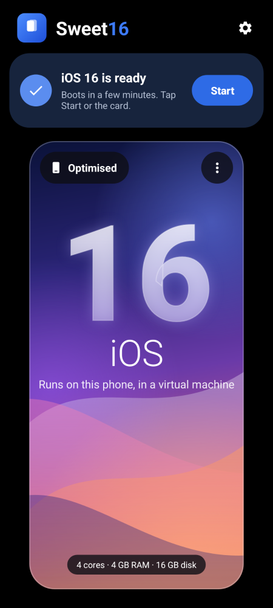

# Sweet16: iOS 16 as an Android app

Sweet16 runs the ios-sweet kernel and the iOS 16.7 userland on any arm64 Android phone, including Samsung Galaxy phones (Exynos or Snapdragon). The phone keeps running Android; iOS runs inside the app.



## How it works

The Redmi port boots XNU on bare metal and drives that phone's own hardware (UFS, Goodix touch, PMIC keys). A Samsung phone has none of that, and an app cannot boot a kernel. So the app emulates a small, fixed machine instead, the **sweet-virt** machine, and the same kernel runs on it:

```
Sweet16 app ── foreground service ── libqemu.so (QEMU, TCG, -M virt, cortex-a76, N cores)
   │                                   ├─ ram.bin + stub.bin   kernel, ADT, boot_args (boot bundle)
   │                                   ├─ virtio-blk           iOS 16 root disk (HFS+ image)
   │  VNC over a unix socket  ◄────────├─ ramfb                the kernel's framebuffer
   │  (screen, touch, keys)   ────────►├─ virtio-tablet/kbd    touch screen, power/volume/home
   │  console viewer          ◄────────└─ PL011 → console.log  kernel console
```

- **Kernel**: patch `xnu/patches/0082-sweet-virt-machine.patch` adds a polled virtio-mmio driver (`bsd/dev/sweet_virtio.c`). It serves the root disk as `ufsroot0` (as on the phone), feeds the virtio tablet and keyboard into the existing HID services, mirrors the console to the PL011, starts extra cores through `hvc` PSCI, and shows frames at half size (`sweetfb_scale=2`). iOS still sees a 1125×2436 iPhone X display. The machine is selected by the `/sweet-virtio` ADT node (`tools/mkadt.py --virt`). The phone build is unchanged.
- **Boot stub** (`tools/virt-stub`): points QEMU's ramfb at the framebuffer through fw_cfg, then jumps to the kernel with `x0 = boot_args`, like the shim does on the phone.
- **QEMU**: Termux's `qemu-system-aarch64` 11.x for Android, repackaged by `tools/fetch-termux-qemu.py` as `lib*.so` files. Android only lets apps execute files from their native library directory.

There is no GPU and no hardware virtualization (Android does not give apps KVM). Every guest instruction is translated by QEMU on the phone's CPU, so expect a slow boot (tens of minutes on the Apple logo the first time) and a low frame rate. Everything the Redmi port lacks (Wi-Fi, audio, camera, App Store) is missing here too.

## What you need

1. **The APK.** Get it from the `android` GitHub Actions workflow (artifact `Sweet16-apk`, which also builds the kernel), or build it yourself (below).
2. **The iOS 16 disk.** iOS is Apple's, so it is not in the APK. Build it on a Linux PC from the iPhone X (iPhone10,3) 16.7.x IPSW, exactly as for the Redmi: `tools/mkiosroot.sh`, then `tools/sweet-root-tweaks.py` (see the main README, step 2). Copy `ios16-root.img`, or the smaller `ios16-root.simg` / `.img.gz`, to the phone, and in the app tap **Import**.
3. **Boot files.** A CI build has them inside. To add the `/product` node of the real iPhone X device tree (MobileGestalt reads it), build your own bundle: `tools/mksweet16.sh kernel.development.sweet out/ sweet16-boot.zip`, then use **⋮ → Import boot files…**.
4. A phone with at least 6 GB of RAM (the guest gets 4 GB) and about 10 GB free storage.

On Samsung phones, open **Settings → Battery: allow background use** in the app. Otherwise One UI may stop the virtual machine when you leave the app.

## Using it

- Tap the card (or **Start**) to boot. The screen opens with the boot log; iOS draws over it once SpringBoard is up.
- Touch works like on an iPhone. **Back** = Home. The handle at the top opens Home, Lock, Volume and the kernel log, and stops iOS.
- Phone volume keys control iOS volume (can be turned off in Settings).
- Settings: CPU cores (more boot faster), QEMU's translation cache size, showing the kernel log on screen, extra boot-args.

## Building the APK

```sh
python3 android/tools/fetch-termux-qemu.py android/app/src/main/jniLibs/arm64-v8a android/app/src/main/assets
tools/mksweet16.sh xnu/out/kernel.development.sweet android/app/src/main/assets/bundle   # optional
cd android && gradle assembleRelease      # Gradle 8.14, JDK 17+, Android SDK 35
```

Needs `patchelf`, `readelf` and `llvm-strip` on the PC.

To try a bundle on a PC with the app's exact QEMU command line, run `tools/qemu-sweet-virt.sh BUNDLE_DIR DISK.img RUN_DIR`. Then view `RUN_DIR/vnc.sock` with any VNC viewer that supports unix sockets.

## Licenses

The app code is MIT like the rest of the repository. QEMU is GPL-2.0, and its libraries are Termux builds. The package versions and source links are in the APK (`assets/qemu/SOURCES.txt`) and shown under Settings → About. The kernel is Apple's open-source xnu (APSL) with this project's patches. Sweet16 is not affiliated with Apple.
